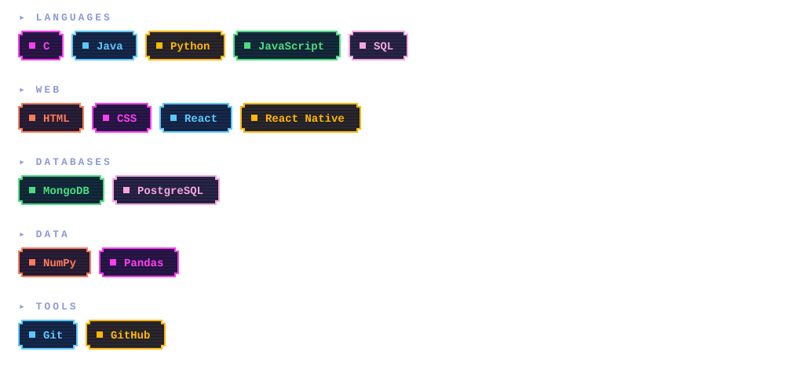
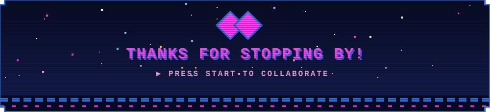

 

 

 

## 🕹️ Player Profile

  

<table align="center">
  <thead>
    <tr>
      <th align="left">🕹️ About</th>
      <th align="left">Details</th>
    </tr>
  </thead>
  <tbody>
    <tr><td>🎓 <b>Who I am</b></td><td>CSE (Data Science) student who loves building projects from scratch</td></tr>
    <tr><td>🧠 <b>Learning</b></td><td>Data Structures &amp; Algorithms, Object-Oriented Programming, Web Development</td></tr>
    <tr><td>🛠️ <b>Building</b></td><td>React web apps and small projects</td></tr>
    <tr><td>🤝 <b>Open to</b></td><td>Collaborating on beginner-friendly projects</td></tr>
  </tbody>
</table>

## 🧰 Inventory (Tech Stack)

## 📊 Score Board

## 🐍 Contribution Snake

 

<!-- Assets live in ./assets as plain SVGs. Edit them directly, or tweak and re-run build_assets.py -->